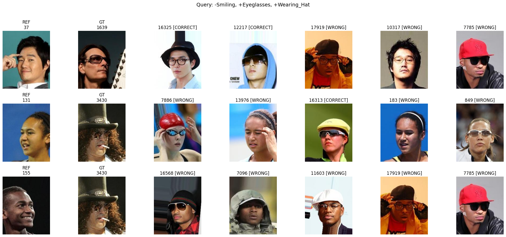

# Compositional Image Retrieval



## Goal

Build a system that, given a reference image and a set of positive (`+`) and negative (`−`) text constraints, retrieves images that preserve the reference's identity while satisfying the constraints. We extend the CLAY framework (Lim et al., 2026) which builds on GDE (Berasi et al., 2025), addressing CLAY's limitation of naïve embedding stacking when handling multiple conditions.

## Constraints

- Model: CLIP ViT-B/32 from HuggingFace
- Deliverable: single self-contained Jupyter notebook on Google Colab
- Evaluate on the mandatory query list in `celeba_evaluation.json`
- Report Recall@K and Precision@K at K=1, 5, 10

## The four threads

We split the work into four experimental threads. Each is independently runnable; later threads compose with earlier ones.

### Thread 1 — Zero-shot baseline

- **What:** Naïve Euclidean arithmetic on CLIP embeddings: `q = v_ref + Σt⁺ − Σt⁻`, then cosine similarity for retrieval.
- **Why:** Establishes the lower bound everyone must beat. Forces us to nail down the evaluation pipeline before specialising.
- **Reference:** Radford et al. 2021 (CLIP); also the brief's described baseline.

### Thread 2 — GDE-style geodesic composition

- **What:** Replace text-derived attribute directions with **image-derived** ones, computed on the unit hypersphere using the logarithm map. Add denoising via CLIP's image-to-text probabilities.
- **Why:** GDE's results show massive gains (Table 1 in their paper) when respecting the manifold geometry vs naïve Euclidean composition. Training-free.
- **Reference:** Berasi et al. 2025 (GDE), Sec. 3.

### Thread 3 — LoRA on CLIP's text tower

- **What:** Inject low-rank adapters into the Q/K/V matrices of CLIP's text encoder. Freeze everything else. Train on a contrastive retrieval objective.
- **Why:** Specialises text representations for attribute-style phrasing without bloating parameters. Tests the training-based paradigm.
- **Reference:** Hu et al. 2022 (LoRA); Zhang et al. 2022 (NOAH) for the prompt-tuning context.

### Thread 4 — CLAY sign-aware subspaces

- **What:** Build separate textual subspaces for positive (`P⁺`) and negative (`P⁻`) constraints using CLAY's manifold-aware tangent-space SVD. Two scoring variants:
  - **B2 (null-space):** project database embeddings _away_ from `P⁻`, then score against `P⁺`
  - **B1 (additive):** `score = sim(q, P⁺v) − λ·sim(q, P⁻v)`
- **Why:** Directly extends CLAY's mechanism to handle CLAY's own limitation: naïve stacking of multiple conditions. Training-free.
- **Reference:** Lim et al. 2026 (CLAY), Sec. 3.2.

## Directory structure

```
repo/
├── OVERVIEW.md
├── README.md
├── data/
├── src/
│   ├── manifold.py
│   ├── eval.py
│   ├── baseline.py
│   ├── gde.py
│   ├── lora.py
│   └── clay.py
├── notebooks/
│   ├── steve.ipynb
│   ├── a.ipynb
│   ├── b.ipynb
│   └── final.ipynb
└── results/
```

## Environment Setup

**Prerequisites:** [uv](https://docs.astral.sh/uv/getting-started/installation/) installed.

```bash
# Clone and enter the repo
git clone ...

# Create the venv and install all dependencies
uv sync

# Activate (optional — uv run does this automatically)
source .venv/bin/activate
```

`uv sync` reads `pyproject.toml` + `uv.lock` and installs the exact pinned versions. PyTorch is resolved automatically for your local CUDA version via `torch-backend = "auto"` — no manual index selection needed.

### Adding a dependency

```bash
uv add <package>          # adds to pyproject.toml and updates uv.lock
git add pyproject.toml uv.lock
git commit -m "add <package>"
```

Never edit `uv.lock` by hand — it's auto-generated.

### Troubleshooting

- **`uv sync` fails on torch:** Make sure your NVIDIA driver is up to date. Run `nvidia-smi` to check your driver version.
- **Different torch version than expected:** This is normal — `torch-backend = "auto"` picks the best wheel for your GPU/driver combo.
- **Colab:** The final notebook pins stable torch directly in a `!pip install` cell. The uv setup is for local dev only.

## Code Quality

Install the pre-commit hooks once after cloning:

```bash
uv run pre-commit install
```

Ruff runs automatically on every commit (lint + format, for `.py` and `.ipynb` files). To run manually:

```bash
uv run ruff check . --fix
uv run ruff format .
```

To update hook versions:

```bash
uv run pre-commit autoupdate
git add .pre-commit-config.yaml && git commit -m "bump pre-commit hooks"
```
